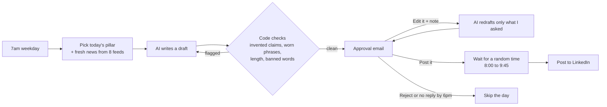

# LinkedIn Auto-Post: an AI writer that asks before it posts

**An n8n workflow (n8n is a visual automation tool) that drafts a LinkedIn post every weekday, emails it to me for approval, takes edit notes, and posts at a natural time.** It has run in production since October 2026 across 13 versions. Every version is measured against real post stats on a dashboard.

The whole 58-node workflow is generated from Python, not clicked together by hand. That means it's versioned, diffable, and deployed with backups and rollbacks.

## How a day works

- **A weekly rhythm.** Monday is an AI concept, Tuesday AI news through a logistics lens, Wednesday a beginner skill, Thursday my own take, and Friday a build log.
- **My own words, not invented ones.** On Wednesday it emails me a trending story and asks what I think. My reply becomes Thursday's post. On Thursday it asks what I built that week, and Friday's post is written from that alone. If I drop a screenshot in a Drive folder, Friday's approval email offers to post it with the picture.
- **The edit loop.** The approval email opens a form: Post it, Edit it or Reject, with a "What should change?" box. An edit sends my note back to the writer, which changes only what I asked, and a new draft arrives. It repeats until a 6pm cutoff. Every note is saved, so repeat corrections can become permanent rules.
- **Natural timing.** Posting the moment I approved hurt reach. Now an approved post waits for a random time between 8:00 and 9:45.

## Guardrails: the model writes, code checks

An AI writing in your name will happily invent experience you don't have. The prompt bans it, but code enforces it:

- **Invented-experience check.** Phrases like "we tested", "last quarter we" or "at my company" flag the draft and send it back for one rewrite. Words that came from my own replies are allowed through. My employer's name is never allowed, even if I typed it.
- **Worn-phrase check.** Stock openers like "Picture a..." and "Here's the thing" are caught in code and rewritten.
- **Links are never typed by the model.** News posts end with "Read the article: <link>", using the exact feed link added in code, so a link can't be made up.
- **Cleanup in code:** dashes, curly quotes, markdown and hashtags are stripped. A 160-word cap gets one rewrite if the first draft runs long.
- **One rewrite, not a loop.** If a draft still fails after one retry, the approval email shows me exactly what was flagged, so token spend stays bounded.

## Built as code, deployed like software

| File | What it does |
|---|---|
| `build_workflow.py` | Generates the whole n8n workflow (58 nodes, prompts, code steps, schedules) as JSON. `USE_CLAUDE` switches the writer between Claude and GPT in one line |
| `workflow-v2.json` | The generated workflow, importable into n8n |
| `push_workflow.py` | Deploys through the n8n API. Dry run by default. It copies node ids and webhook ids from the live workflow, so approval emails already in my inbox keep working. It backs up live first, saves a draft, then publishes with a version name and notes |
| `versions.csv` | Changelog of every version: what changed, and whether it changed the writing or only the process |
| `analytics/pull_linkedin.py` | Sunday import: reads the LinkedIn stats export and joins it to what the workflow logged (pillar, topic, link or not, real post time) |
| `analytics/build_dashboard.py`, `template.html` | Builds the dashboard below |

Every publish saves a snapshot and a `versions.csv` row. To roll back, push an old snapshot as a new version.

## Measuring what changes do

The dashboard shows account totals, every post's impressions by day, follower growth, and two panels built for decisions:

- **By version:** median impressions and engagement per writing era, so each change to the writer is judged on its own posts.
- **The link test:** a real question I had. Does LinkedIn punish posts with outbound links? It compares news posts with and without a link, counting only posts 7+ days old so each has had its full run. So far there is no penalty.

Process-only changes (a new button, an email tweak) stay inside the current era so they don't muddy the comparison. Groups under 4 posts say "too early" instead of pretending.

## Setup

1. In n8n, create the credentials (Gmail, Google Drive, LinkedIn, Anthropic or OpenAI) and three data tables: `li_posts`, `li_topics`, `li_takes`.
2. Fill in the placeholder ids at the top of `build_workflow.py`, and set your employer's name in the invented-experience check.
3. `python build_workflow.py`, then import `workflow-v2.json`, or deploy with `python push_workflow.py "name" "notes"` (dry run), then add `--go`.

Environment variables: `N8N_URL`, `N8N_API_KEY`, `LI_WORKFLOW_ID`, `LI_APPROVER_EMAIL`. No keys are stored in the code.

---

Built by Joshua with Claude Code, 2026.
